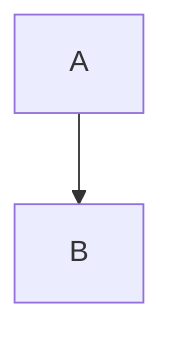

# Markdown preview host fixture

Plain paragraph with the same **same** word twice.

A table:

| Column | Value |
|--------|-------|
| one    | 1     |
| two    | 2     |

- [x] finished item
- [ ] open item



```c
int main(void) { return 0; }
```


